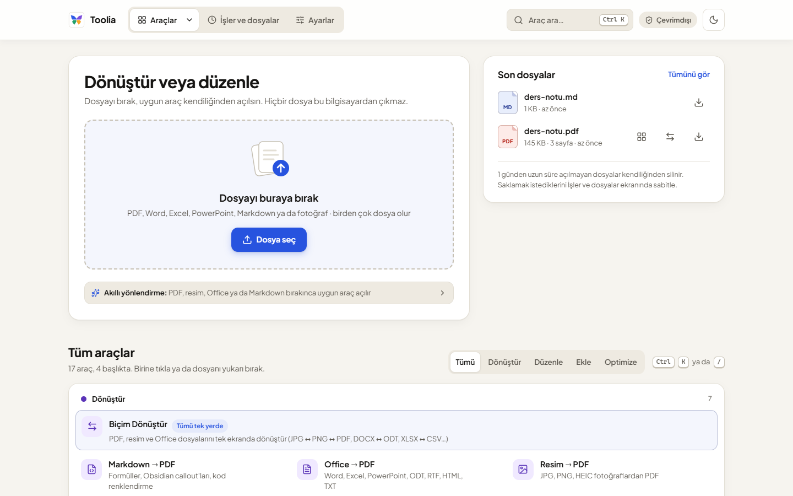
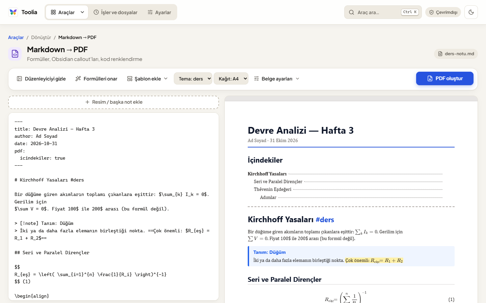
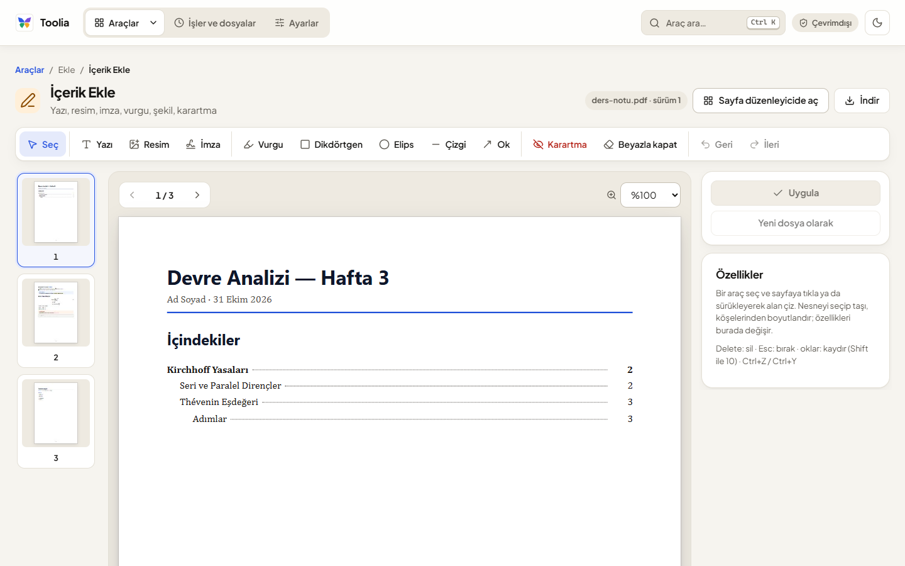

# Toolia

**An offline PDF and document toolkit for Windows.** Convert, edit, OCR, compress and encrypt
documents on your own machine: no sign-up, no upload limits, and files never leave the computer.
The interface is in Turkish; Türkçe açıklama aşağıda.



| Markdown → PDF with live preview | Annotation editor |
|---|---|
|  |  |

## What it does

- **Convert:** Markdown / Word / Excel / PowerPoint / HTML → PDF, PDF → Word / Excel / images,
  and format conversion for images (HEIC → JPG, PNG ↔ WEBP…) and Office files (DOCX ↔ ODT,
  XLSX ↔ CSV…).
- **Edit:** a drag-and-drop page editor (reorder, rotate, delete, insert, undo/redo, full
  keyboard support), an annotation editor (text, images, signatures, shapes) and true
  redaction that removes the underlying content, not just covers it.
- **Process:** merge, split, watermark, page numbers, three-level compression, Turkish + English
  OCR, AES-256 encryption, metadata cleanup and PDF repair.
- **Markdown → PDF:** live preview, LaTeX math (KaTeX), chemistry formulas, Obsidian syntax
  (callouts, wiki links, embeds), code highlighting, table of contents and themes.
- **Phone mode:** use it from a phone on the same Wi-Fi through a one-time QR pairing.
- **CLI:** every tool is also available from the command line.

## Engineering highlights

- **Architecture:** Python + FastAPI backend with a job queue, React 19 + TypeScript (Vite)
  frontend, running as a desktop window in Edge app mode. External engines: PyMuPDF,
  LibreOffice, Tesseract, Ghostscript and headless Edge.
- **Security-hardened local server:**
  - Document rendering runs with the network fully blocked, and LibreOffice runs with macros
    disabled in a fresh profile.
  - Office zip bombs are rejected before they are unpacked, Origin headers are checked
    (including the port), and phone sessions use one-time QR codes, are bound to the paired network
    address and expire after 8 hours.
  - A dedicated security test suite measures network egress during every conversion.
- **Testing and CI:** 540+ pytest tests (unit, security and end-to-end with the built UI),
  85 Vitest tests, ruff and ESLint. GitHub Actions runs everything on Windows and Ubuntu on
  every push.
- **Distribution:** a one-file installer package with no admin rights and no Python/Node
  needed, versioned releases with a [CHANGELOG](CHANGELOG.md) and a SHA-256 checksum next to
  every package.

## Tech stack

Python · FastAPI · PyMuPDF · React · TypeScript · Vite · pytest · Vitest · GitHub Actions

## Quick start (from source)

```powershell
winget install astral-sh.uv
winget install OpenJS.NodeJS.LTS
git clone https://github.com/CagriBurk/Toolia.git; cd Toolia
uv sync; npm --prefix web install; npm --prefix web run build
uv run python -m toolia serve        # http://127.0.0.1:8790
```

LibreOffice, Tesseract and Ghostscript are optional engines; the Settings page shows which
ones are missing and how to install them. Windows users can instead download the ready-made
package from [Releases](https://github.com/CagriBurk/Toolia/releases).

More documentation (in Turkish): [user guide](docs/KULLANIM.md),
[security hardening plan](GUVENLIK_PLANI.md) and [changelog](CHANGELOG.md).

License: [GNU AGPL v3](LICENSE).

---

## Türkçe

Toolia (eski adı PDF Atölyesi), bilgisayarında çevrimdışı çalışan bir PDF ve belge aracıdır.
Dosyalar internete çıkmaz; kayıt, reklam ya da dosya boyutu sınırı yoktur.

### Neler yapar

- **Dönüştürme:** Markdown, Word, Excel, PowerPoint ve HTML → PDF; PDF → Word, Excel ve resim.
  Resim (HEIC → JPG, PNG ↔ WEBP) ve Office biçimleri (DOCX ↔ ODT, XLSX ↔ CSV) arasında dönüştürme.
- **Düzenleme:** sürükle-bırak sayfa düzenleyici; yazı, resim ve imza ekleme; altındaki içeriği
  gerçekten silen karartma.
- **İşleme:** birleştirme, bölme, filigran, sayfa numarası, sıkıştırma, Türkçe + İngilizce OCR,
  AES-256 şifreleme.
- **Markdown → PDF:** canlı önizleme, LaTeX formüller, Obsidian sözdizimi, içindekiler ve temalar.
- **Telefon modu:** aynı Wi-Fi'deki telefondan, tek kullanımlık QR kodla eşleşerek kullanım.
- **Komut satırı:** bütün araçlar `python -m toolia` ile de çalışır.

### Kurulum

**Windows paketi:** [Releases](https://github.com/CagriBurk/Toolia/releases) sayfasından
`Toolia-<sürüm>.zip` dosyasını indir, ayıkla ve `Kur.cmd` dosyasına çift tıkla. Python ya da
yönetici izni gerekmez.

**Kaynak koddan:**

```
uv sync
npm --prefix web install
npm --prefix web run build
uv run python -m toolia serve      # http://127.0.0.1:8790
```

Office dönüşümleri LibreOffice, OCR Tesseract ve Ghostscript ister. Eksik olanları Ayarlar
sayfası gösterir.

### Geliştirme

```
uv run python -m pytest            # birim, güvenlik ve uçtan uca testler
uv run python -m ruff check .
npm --prefix web test              # arayüz testleri (Vitest)
npm --prefix web run lint
```

GitHub Actions her gönderimde bu denetimleri Windows ve Ubuntu'da çalıştırır
([ci.yml](.github/workflows/ci.yml)).

### Belgeler

- [Kullanım kılavuzu](docs/KULLANIM.md): ekranlar, komut satırı, telefon modu, sorun giderme,
  ayrıntılı kurulum
- [Güvenlik sertleştirme planı](GUVENLIK_PLANI.md)
- [Proje planı](PLAN.md) ve [değişiklik günlüğü](CHANGELOG.md)

### Lisans

[GNU AGPL v3](LICENSE). PyMuPDF ve Ghostscript de AGPL lisanslıdır; paketteki bileşenlerin
lisansları `LISANSLAR.txt` dosyasındadır.
